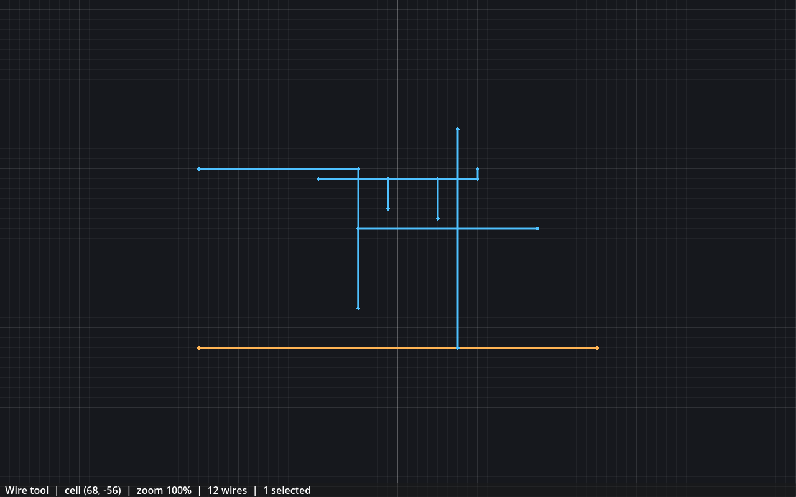

<div align="center">

# open-logic

**An open-source digital logic circuit designer. Start from a NAND gate, end with a CPU.**

[](LICENSE)
[](https://godotengine.org)
[](https://github.com/maximcuynat/open-logic/releases)
[](https://maximcuynat.github.io/open-logic/)

</div>

> **Status: early development (v0.x).** The editor can draw wires on a grid.
> Gates and simulation come next, see the [roadmap](docs/ROADMAP.md).



## Why

Tools like Logisim are great for teaching, but building anything non-trivial
is slow and fiddly. open-logic aims to be a fast, keyboard-friendly circuit
editor where every component, up to a working processor, can be built from a
single primitive: the NAND gate.

## Features

- Infinite grid with smooth pan and zoom (mouse and trackpad)
- Orthogonal wire drawing with automatic L routing
- Selection, deletion, unlimited undo/redo
- Human-readable, versioned file format (`.olc`, JSON) and autosave
- Runs on macOS, Windows, Linux and in the browser

## Download

Grab the latest build for your platform from the
[releases page](https://github.com/maximcuynat/open-logic/releases), or
[play it in your browser](https://maximcuynat.github.io/open-logic/).
Each release ships a `SHA256SUMS` file to verify downloads.

> Builds are not code-signed yet. On macOS, right-click the app and choose
> **Open** the first time. On Windows, click **More info > Run anyway**.

## Controls

| Action | Input |
|---|---|
| Draw a wire | Wire tool (`W`), click and drag. Hold `Shift` to flip the corner |
| Select a wire | Select tool (`V`), click |
| Delete | `Backspace` / `Delete` on the selection, or right-click a wire |
| Pan | Middle mouse drag, `Space` + drag, or two-finger scroll |
| Zoom | Mouse wheel or pinch |
| Undo / Redo | `Cmd/Ctrl+Z` / `Cmd/Ctrl+Shift+Z` |
| Cancel | `Esc` |

## Building from source

Requirements: [Godot 4.7](https://godotengine.org/download), GNU Make, and for
the development tooling `gdtoolkit`, `gitleaks`, `git-cliff` and `gh`.

```sh
git clone https://github.com/maximcuynat/open-logic.git
cd open-logic
make doctor   # check the toolchain
make hooks    # install git hooks
make run      # launch the editor
make check    # lint + tests + smoke test
```

See [CONTRIBUTING.md](CONTRIBUTING.md) for the full workflow and
[docs/ARCHITECTURE.md](docs/ARCHITECTURE.md) for how the code is organised.

## License

open-logic is free software released under the
[GNU General Public License v3.0](LICENSE). Derivative works must be
distributed under the same license.
